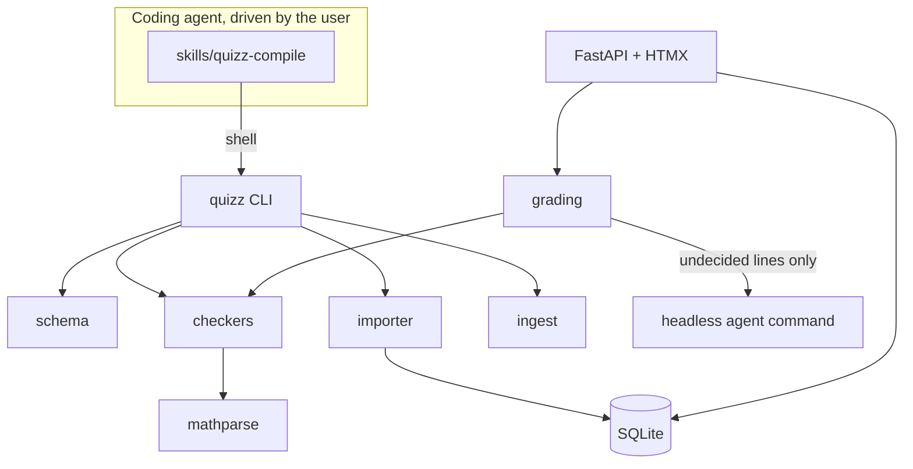
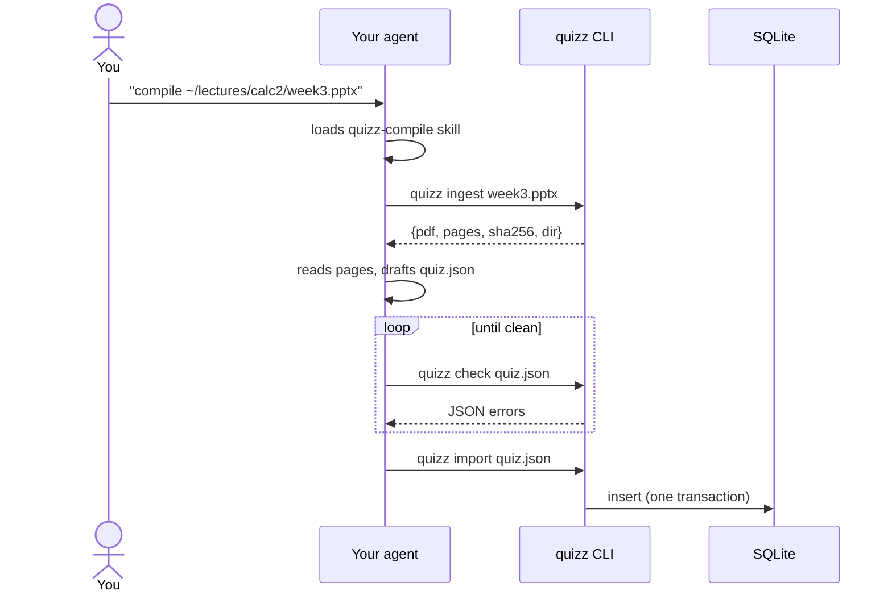

# quizz-maker — Design

Date: 2026-10-12 · Status: approved in brainstorming, pending spec review

## 1. Goal

A local, single-user application that turns lecture slides into browser-served quizzes.

- A **coding agent** (Claude Code, Codex, pi, …) acts as a *compiler*: driven by the user in their own terminal, it reads slides and emits a quiz package in a defined format, guided by an Agent Skill.
- All verification is **deterministic first**: a `quizz` CLI validates packages and proves every exercise's reference solution with the same checkers used at grading time.
- A **FastAPI + HTMX + SQLite** web app serves quizzes, grades answers deterministically, and calls a headless agent **only** for solution lines checkers cannot decide.

Initial subjects: Calculus 2, General Chemistry 2, Fundamental Physics 2, Signals & Systems. The checker registry is pluggable so more domains can be added later (e.g. a Lean checker for proof-based courses).

### Non-goals (v1)

- Multi-user, accounts, hosting.
- Spaced repetition, ad-hoc quiz mixes, partial credit on exercises.
- MCP server (can later wrap the same Python functions as the CLI).
- Lean or other proof assistants (the checker interface allows adding them).
- The web app never initiates compilation.

### Decisions log

| Topic | Decision |
|---|---|
| Users / deployment | Just me, locally |
| Exercise checking | SymPy-family deterministic checkers; Lean deferred (poor fit for computational subjects) |
| Undecidable lines | Live headless agent call at submission time |
| Math input | MathLive visual editor → LaTeX → SymPy |
| Slide formats | PDF and PPTX (PPTX normalized to PDF) |
| Study loop | One quiz per lecture + attempt history |
| Question types | MCQ, multi-select, fill-in-the-blank, math/numeric answer, step-by-step exercise |
| Content storage | SQLite is the source of truth; imported JSON kept under gitignored `library/` |
| Agent protocol | Agent Skills (`SKILL.md`) + `quizz` CLI with JSON I/O |
| UI | Claude-style; layout "Focus" (one question at a time, bottom composer); Teal palette |
| Repo | Lecture-agnostic: no lecture content committed |

## 2. Architecture

```
quizz-maker/
├── pyproject.toml            # uv, Python 3.12
├── src/quizz/
│   ├── schema/               # Pydantic models = quiz package format v1 (source of truth)
│   ├── mathparse/            # MathLive LaTeX → SymPy (single parser for content and answers)
│   ├── checkers/             # registry: expr_equiv, antiderivative, numeric_units, reaction_balance, …
│   ├── grading/              # per-question grading; step pipeline; agent fallback
│   ├── ingest/               # PPTX → PDF (headless LibreOffice); page text + images
│   ├── importer/             # validate → verify → insert (one transaction)
│   ├── db/                   # SQLite schema, numbered .sql migrations, queries (stdlib sqlite3)
│   ├── web/                  # FastAPI routes, Jinja2 templates, HTMX, static assets
│   └── cli.py                # `quizz` entry point (Typer)
├── skills/quizz-compile/     # Agent Skill: SKILL.md + references/ + examples/
├── tests/
├── library/                  # gitignored: imported JSON packages   ┐
├── build/                    # gitignored: ingest output + drafts   ├ under $QUIZZ_HOME
└── quizz.db                  # gitignored                           ┘
```

**Data directory.** `build/`, `library/` and `quizz.db` live under `$QUIZZ_HOME`, never under the agent's working directory. Default: the checkout root of the editable install (the directory holding `pyproject.toml`, resolved from the package's location), which matches the gitignored layout above. `QUIZZ_HOME` overrides it.



### Invariants

1. **One grading code path.** `quizz check` (compile time) and web submissions (runtime) call the same `grading` functions.
2. **Pydantic models are the format.** `quizz schema` emits JSON Schema generated from them.
3. **Only the importer writes content tables.** The web app writes only attempts, answers, settings.
4. **Agent verdicts never override deterministic verdicts.**
5. **No user- or agent-supplied string is ever passed to `eval`/`sympify`.** Expressions are built only by `mathparse` and whitelisted grammars (units, chemical formulas).
6. **No lecture content in git.**

### Compile flow (user drives the agent)



## 3. Quiz package format (v1)

A package is a directory: `quiz.json` plus optional `assets/` (figures cropped from slides). On import, assets are stored as DB blobs.

### Envelope

```json
{
  "format_version": 1,
  "id": "calc2-w03-integration-by-parts",
  "title": "Integration by Parts",
  "course": "Calculus 2",
  "source": { "filename": "week3.pptx", "sha256": "…" },
  "questions": [ … ]
}
```

`id`: lowercase slug `[a-z0-9-]+`, stable across re-compiles; re-importing the same `id` creates a new revision.

### Common question fields

| Field | Type | Notes |
|---|---|---|
| `id` | string | unique within the quiz, `[a-z0-9-]+` |
| `type` | enum | `mcq`, `multi_select`, `fill_blank`, `math_answer`, `exercise` |
| `prompt` | string | Markdown with `$…$` / `$$…$$` LaTeX (rendered by KaTeX) and `` images |
| `source_slides` | int[] | 1-based page numbers in the ingested PDF |
| `explanation` | string | Markdown, shown in the verdict panel |
| `points` | int ≥ 1 | default 1 |

### Type-specific fields

| `type` | Fields | Grading |
|---|---|---|
| `mcq` | `choices: [{id, text}]` (2–6), `answer: <choice id>` | exact |
| `multi_select` | `choices`, `answer: [<choice id>…]` (≥1), `scoring: all_or_nothing \| partial` | set match; `partial` = `max(0, (correct − incorrect) / |answer|) × points` |
| `fill_blank` | prompt contains `{{key}}` placeholders; `blanks: {key: {accept: [string…], match: normalized \| exact \| regex}}` | per blank, equal weight; `normalized` = casefold, trim, collapse whitespace, strip trailing punctuation |
| `math_answer` | `check: CheckSpec` | checker |
| `exercise` | `context`, `steps_mode`, `start?`, `final: CheckSpec`, `reference_solution`, `rubric` | step pipeline (§4) |

### CheckSpec

`{ "checker": "<name>", "params": { … } }`. Each checker declares a params schema (validated at import) and an **input widget**: `math` (MathLive) or `text` (plain input, e.g. chemical equations). v1 checkers:

| Checker | Params | Widget | Passes when |
|---|---|---|---|
| `expr_equiv` | `expected` (LaTeX), `vars: {name: real\|positive\|integer\|complex}` | math | answer ≡ expected (symbolic, else numeric sampling) |
| `antiderivative` | `integrand` (LaTeX), `var` | math | d/dvar(answer) ≡ integrand |
| `numeric_units` | `expected` (number), `unit` (string, e.g. `m/s^2`), `rel_tol`, `abs_tol?`, `sig_figs?` | math | value converted to `unit` within tolerance; dimensions match; sig figs match if set |
| `reaction_balance` | `reactants: [formula]`, `products: [formula]` | text | same species, smallest positive integer coefficients, atoms and charge conserved |
| `transform` | `kind: laplace\|fourier\|z`, `expected` (LaTeX), `var`, `region_of_convergence?` | math | answer ≡ expected (same rule as `expr_equiv`); ROC compared if given |

### Exercise fields

- `context`:
  - `symbols: {name: {assumptions: [real, positive, …], unit?: string, description?: string}}` — symbols shown to the user as available.
  - `givens: {name: {value: number, unit: string}}`.
  - `relations: [LaTeX equation]` — governing equations (e.g. `F = m a`), optional.
- `steps_mode`: `chain` or `derivation` (§4).
- `start`: LaTeX expression line 0 is compared against in `chain` mode.
- `final`: CheckSpec applied to the last line.
- `reference_solution: [{latex, justification?, agent_graded?: bool}]`.
- `rubric`: plain text given to the agent grader for undecided lines.
- `require_justification: [int]` — reference line indices whose justification must be present and is graded by the agent.

All math strings use the **MathLive LaTeX dialect** so content and answers share one parser.

## 4. Checkers & step grading

### Line verdicts

| Verdict | Meaning |
|---|---|
| `pass` | proven by a checker |
| `pass_numeric` | symbolic proof failed; matched at all valid sample points |
| `fail` | disproved; carries a reason and, when available, a counterexample |
| `undecided` | sent to the agent grader |
| `agent_pass` / `agent_fail` | judged by the agent; carries a comment |
| `unverified` | undecided and the agent was unavailable or failed |
| `parse_error` | could not be parsed; returned to the user, never graded or sent to the agent |

### Pipeline

1. **Parse** each submitted line with `mathparse`. A line is an expression, an equation chain `lhs = rhs [= …]`, or a definition `newsym = expr`; each may carry a prose justification.
2. **Check each line** by `steps_mode`:
   - **`chain`** (calculus, signals): line *i* must be equivalent to line *i−1*; line 0 must be equivalent to `start`.
     - Equivalence: `simplify(a − b) == 0` within budget → `pass`. Else evaluate both at 30 seeded random points respecting symbol assumptions: any mismatch beyond tolerance → `fail` with counterexample; all match with ≥ 20 valid points → `pass_numeric`; < 20 valid points → `undecided`.
     - Unevaluated integrals and arbitrary constants (`C`, `C_{n}`): try `doit()`; otherwise compare derivatives with respect to the integration variable (equivalence modulo constants).
     - Definition lines (`u = x^2`) add a substitution; later lines are compared after back-substitution. Lines changing the differential are attempted via `doit()` on both sides; failure → `undecided`.
   - **`derivation`** (physics, chemistry): each line must be **true under the context**.
     - Substitute givens (with units, via `sympy.physics.units`) and quantities defined on earlier lines; all sides must agree within tolerance and be dimensionally consistent → `pass`, else `fail`.
     - A definition of a declared symbol is compared against the value of that symbol in `reference_values` — a `{symbol: {value, unit}}` map the importer computes by evaluating the reference solution and stores alongside the question in `data_json`; mismatch → `fail` (this localizes the first wrong line).
     - A symbolic line (no numeric evaluation possible) is checked as implied by `relations` (solve relations for the line's subject and compare). Not decidable → `undecided`.
3. **Final answer:** the last line is checked with `final`. Sig figs are evaluated only here, from the literal the user typed.
4. **Agent fallback:** `undecided` lines plus lines listed in `require_justification` go to one agent call per submission (§6.3).

### Scoring

| Type | Score |
|---|---|
| `mcq`, `math_answer` | `points` or 0 |
| `multi_select` | per `scoring` |
| `fill_blank` | `points × correct_blanks / total_blanks` |
| `exercise` | `points` iff final passes and no line is `fail`/`agent_fail`/`parse_error`; else 0. `unverified` does not count as fail; the attempt is flagged "has unverified lines". |

### Compile-time gates (`quizz check`, `quizz import`)

- JSON Schema validation; checker params validation.
- Referential checks: MCQ/multi-select answer ids exist; fill-blank placeholders match `blanks` keys; referenced assets exist; `source_slides` lie within the page count of the ingest manifest whose `sha256` equals `source.sha256` (looked up under `$QUIZZ_HOME/build/*/manifest.json`; skipped with a warning if none matches).
- Every reference-solution line must get `pass` or `pass_numeric` **without the agent**, unless flagged `agent_graded: true` (requires non-empty `rubric`). The reference's final line must pass `final`.
- **Mutation test:** each checker defines `mutants(params)` — wrong answers that must **fail** the CheckSpec, rejecting vacuous checks (e.g. a huge tolerance). `expr_equiv` / `antiderivative` / `transform`: × 2, sign flip, drop one additive term (when ≥ 2 terms). `numeric_units`: value × (1 + 10·rel_tol), value in a different unit of the same dimension without conversion. `reaction_balance`: one coefficient + 1. Applies to `math_answer` and exercise `final`.

### Determinism and budgets

- Sample points are seeded by `(quiz_id, question_id, line_index)`.
- Each line check runs in a worker process with a 3 s budget; on timeout the symbolic step is abandoned and numeric sampling is used; if that also times out → `undecided`.

## 5. `quizz` CLI & compiler skill

### CLI contract

- stdout is JSON by default; `--human` pretty-prints.
- Exit codes: `0` ok, `1` content invalid, `2` usage/environment error.
- Error shape: `{"path": "/questions/3/final/params/unit", "code": "unknown_unit", "message": "…", "hint": "…"}`.

| Command | Behavior |
|---|---|
| `quizz ingest <file.pdf\|file.pptx>` | PPTX → PDF via `soffice --headless --convert-to pdf`; writes `$QUIZZ_HOME/build/<stem>/source.pdf`, `pages/NNN.txt` (text), `pages/NNN.png` (rendered page) and `manifest.json` (`{sha256, pages, filename}`). Prints `{pdf, pages, sha256, dir}`. |
| `quizz schema [--type T]` | JSON Schema of the package or one question type |
| `quizz checkers` | name, params schema, widget, worked example per checker |
| `quizz check <quiz.json> [--question ID]` | all compile-time gates; writes nothing |
| `quizz import <quiz.json>` | runs `check`; computes `reference_values`; inserts in one transaction; then copies the package to `$QUIZZ_HOME/library/<id>/r<revision>/` |
| `quizz list` / `quizz rm <id>` | list quizzes; remove a quiz and its attempts (asks for confirmation unless `--yes`) |
| `quizz install-skill` | symlinks `skills/quizz-compile` into `~/.claude/skills/` (Claude Code) and `~/.agents/skills/` (Codex, pi) |
| `quizz serve [--port 8000]` | starts the web app |

Installed with `uv tool install -e .` so `quizz` is on `PATH` for every agent.

### Skill: `skills/quizz-compile/`

Agent Skills format (`SKILL.md` with `name: quizz-compile` and a `description` naming slides, lectures, quiz compilation as triggers). Contains instructions only; all logic lives in the CLI.

`SKILL.md` workflow:

1. `quizz ingest <file>`; read every page's text and image.
2. Outline concepts per slide range.
3. Choose a question mix. Default per lecture: 8–15 MCQ/multi-select/fill-blank for concepts, 3–6 `math_answer`, 2–4 `exercise`; the user's prompt overrides.
4. Write exercises as **new problems modeled on slide examples**, not copies of worked examples. Pick checkers via `quizz checkers`; pick `steps_mode` per `references/exercises.md`. Write the package to `<ingest dir>/package/quiz.json`, with figures under `<ingest dir>/package/assets/`.
5. Run `quizz check <ingest dir>/package/quiz.json`; fix every error; repeat until exit 0.
6. Run `quizz import`; report the quiz id and the question counts by type.

Supporting files:

- `references/format.md` — field-by-field guide.
- `references/exercises.md` — `chain` vs `derivation` by subject; MathLive LaTeX rules; unit syntax; chemical formula syntax.
- `examples/` — one small valid package per subject (Calc 2, Physics 2, Chem 2, Signals); also used as test fixtures.

## 6. Web app

### 6.1 Database (stdlib `sqlite3`, WAL mode, numbered migrations)

| Table | Columns |
|---|---|
| `quiz` | `id` PK, `title`, `course`, `current_revision` |
| `quiz_revision` | (`quiz_id`, `revision`) PK, `package_json`, `source_sha256`, `imported_at` |
| `question` | (`quiz_id`, `revision`, `question_id`) PK, `position`, `type`, `data_json` |
| `asset` | (`quiz_id`, `revision`, `path`) PK, `mime`, `bytes` BLOB |
| `attempt` | `id` PK, `quiz_id`, `revision`, `started_at`, `finished_at`, `score`, `max_score` |
| `answer` | (`attempt_id`, `question_id`) PK, `response_json`, `verdict_json`, `status` (`graded` \| `pending_agent`), `score`, `graded_at` |
| `setting` | `key` PK, `value` |

Attempts pin a revision; re-import never changes history.

### 6.2 Pages and HTMX flow

| Route | Purpose |
|---|---|
| `GET /` | serif greeting + course/quiz picker; empty state tells the user to run the `quizz-compile` skill |
| `GET /quiz/{id}` | title, course, question counts by type, attempt history (date, score, unverified flag), Start |
| `POST /quiz/{id}/attempts` | create attempt on current revision → redirect to question 1 |
| `GET /attempts/{aid}/q/{n}` | focus view for question *n*; already-answered questions render in verdict state |
| `POST /attempts/{aid}/q/{n}` | grade; returns the verdict fragment that replaces the composer. Answering is once per question per attempt. |
| `GET /attempts/{aid}/q/{n}/verdict` | verdict fragment; polled every 2 s while `pending_agent` |
| `POST /attempts/{aid}/q/{n}/regrade` | retry agent grading for `unverified` lines |
| `GET /attempts/{aid}/summary` | score, per-question ✓ / ✗ / unverified list linking back; finishing sets `finished_at` |
| `GET /assets/{quiz}/{rev}/{path}` | serve asset blob |
| `GET/POST /settings` | grader command and timeout |

**Shell:** collapsible left sidebar (+ New attempt, courses → quizzes, recent attempts with in-progress markers that resume at the first unanswered question); main column centered, max ~720 px.

**Composer by type** (bottom-pinned, rounded):

| Type | Composer |
|---|---|
| `mcq` | stacked choice rows, keys `1`–`6` select |
| `multi_select` | choice rows with checkboxes |
| `fill_blank` | blanks are inline inputs in the serif prompt (Tab between them); composer is an action bar only |
| `math_answer` | one `<math-field>`, or a text input for `text`-widget checkers; hint line shows unit / sig-fig rules |
| `exercise` | one `<math-field>` row per step, optional reason line per step; `⏎` new step, `⌥⏎` add reason; grows upward, scrolls when long |

Shortcuts: `⌘⏎` Check; `⏎` on a verdict → Next.

**Verdict panel** (replaces composer): score; per-line marks with badges `checker`, `numeric`, `agent`, `unverified`; failure reason under each failed line; ◌ on lines pending the agent; explanation; "Reference solution" toggle; Next.

A small JS shim serializes composer state (math-field LaTeX values, reasons, blanks) into a JSON form field on submit.

### 6.3 Live grader protocol

- **Settings:** `grader.command` — shell command template run via `sh -c`; if it contains `{prompt_file}`, that placeholder is replaced with the shell-quoted path of a temp file holding the prompt, otherwise the prompt is written to stdin. Examples: `claude -p`, `codex exec "$(cat {prompt_file})"`, `pi -p "$(cat {prompt_file})"`. `grader.timeout` default 120 s. Unset by default → undecided lines become `unverified` immediately.
- **Execution:** asyncio subprocess in its own process group, launched from a temp working directory as a background task after the verdict fragment is returned; answer `status = pending_agent` until done.
- **Prompt:** self-contained — exercise prompt, context, reference solution, rubric, every submitted line with its deterministic verdict, and the explicit list of line indices to judge. It requires the response to end with JSON: `{"lines":[{"index":3,"verdict":"pass"|"fail","comment":"…"}]}`.
- **Parsing:** last JSON object in stdout, validated with Pydantic. Entries for indices not requested are dropped. Results map to `agent_pass` / `agent_fail`.
- **Failure:** timeout, non-zero exit, invalid JSON, or stdout > 1 MB → process group killed; requested lines become `unverified` with the reason; Retry available.

### 6.4 Visual system

- Claude-style layout ("Focus"), Teal palette, theme follows `prefers-color-scheme`:

| Token | Light | Dark |
|---|---|---|
| canvas | `#FAF9F5` | `#1F2423` |
| sidebar | `#EFEEE7` | `#1A1E1D` |
| card / composer | `#FFFFFF` | `#2A302F` |
| ink | `#2F3433` | `#E7ECEA` |
| muted | `#83877F` | `#94A09C` |
| border | `#E2E1D8` | `#36403E` |
| accent | `#2F6F6A` | `#5FB3A9` |
| ok | `#3F7D4F` | `#8CC49A` |
| bad | `#B2493E` | `#E58374` |

- Type: Source Serif 4 (questions, explanations), Inter (UI); both OFL, vendored woff2.
- One plain-CSS stylesheet driven by custom properties; no build step. HTMX, MathLive, KaTeX vendored under `static/` and themed through the same variables.

## 7. Error handling

| Where | Failure | Behavior |
|---|---|---|
| CLI | missing `soffice` / PDF renderer | exit 2, `code: missing_dependency`, install hint |
| Import | any gate fails | nothing written; errors with JSON-pointer paths |
| Import | crash mid-insert | transaction rollback; package copy happens only after commit; copy failure → warning (DB remains source of truth) |
| Parser | unsupported LaTeX | `parse_error` for that line with offending token; other lines still graded |
| Checker | `simplify` exceeds budget | fall through to numeric sampling, then `undecided` |
| Checker | sample-point domain errors | point skipped; < 20 valid of 30 → `undecided`, never `pass` |
| Grader | timeout / exit ≠ 0 / bad JSON / oversized output | kill process group; `unverified` with reason; Retry |
| App start | answers left `pending_agent` | marked `unverified` |
| Web | unknown ids | 404 |
| Web | re-answer attempt | existing verdict fragment returned |
| Web | HTMX request error | inline error fragment |

## 8. Testing (pytest)

- **`mathparse` golden table:** MathLive-emitted LaTeX (fractions, integrals, `\cdot`, implicit multiplication, subscripts, `\mathrm{}`, units, Greek, piecewise) → expected SymPy; known-bad inputs → expected errors.
- **Checkers:** pass / fail / undecided per checker; boundaries — tolerance edges, sig figs (`2.88\times10^{-4}` vs `2.9\times10^{-4}`), unit conversion (`mJ` vs `J`), constants of integration, counterexample reporting, unbalanced or non-minimal reaction coefficients, charge conservation.
- **Step pipeline:** `chain` and `derivation` scenarios asserting the first wrong line is flagged and later correct lines still pass; substitution lines; routing to `undecided`; budget timeout path.
- **Importer:** every `skills/quizz-compile/examples/*` package imports cleanly; mutated packages (bad unit, vacuous tolerance, missing MCQ answer id, broken reference step, placeholder/blank mismatch) fail at the exact path; rollback leaves DB unchanged; re-import creates a revision and leaves existing attempts intact.
- **Grader:** fake agent command (Python script) returning valid JSON, garbage, out-of-scope indices, or sleeping past timeout; agent verdicts never override deterministic ones; stuck `pending_agent` recovery at startup.
- **Web:** FastAPI `TestClient` flow — start attempt → answer each of the five types → summary; assert fragments and DB state.
- **Browser smoke:** one Playwright test typing steps into `<math-field>` rows and asserting the submitted JSON.
- **Skill acceptance (manual):** compile one real deck per subject; `quizz check` clean; take the quiz in the browser.
